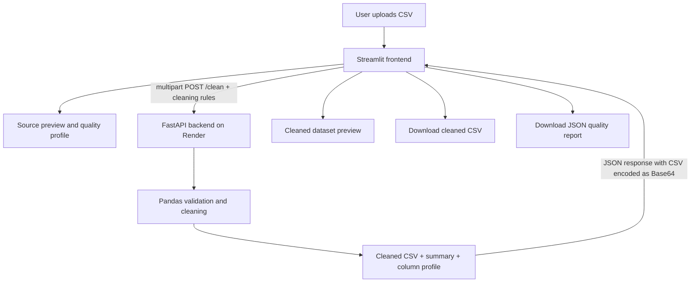

# ClearCSV — Data Quality Studio

<p align="center">
  <strong>Turn messy CSV files into analysis-ready datasets.</strong><br>
  A deployed data-cleaning and quality-profiling app built with Streamlit, FastAPI and Pandas.
</p>

<p align="center">
  <a href="https://clearcsv-data-quality-studio.streamlit.app/">Live application</a> ·
  <a href="https://clearcsv-api.onrender.com/docs">API documentation</a> ·
  <a href="https://clearcsv-api.onrender.com/health">API health</a>
</p>

## Overview

ClearCSV is a web application for uploading CSV datasets, inspecting data quality, applying configurable cleaning rules, and exporting both a cleaned CSV and a JSON quality report. The Streamlit interface calls a separate FastAPI service; Pandas performs the data processing.

**Live demo:** https://clearcsv-data-quality-studio.streamlit.app/  
**Backend API:** https://clearcsv-api.onrender.com  
**Swagger docs:** https://clearcsv-api.onrender.com/docs

> The API is hosted on a free Render instance. After inactivity, its first request may be delayed while the service wakes up.

## Features

- **CSV upload and preview** — inspect source rows and column types before cleaning.
- **Data quality profile** — missing-cell counts, duplicate rows, completeness, unique values and data types.
- **Configurable cleaning rules**
  - Remove duplicate rows.
  - Trim leading and trailing whitespace.
  - Normalize text to lowercase, Title Case or uppercase.
  - Convert numeric-looking columns when conversion is safe.
  - Handle missing values with a smart strategy, `N/A`, `0`, or row removal.
- **Before-and-after summary** — compare row counts, removed rows and remaining missing cells.
- **Exports** — download the cleaned CSV and a JSON quality report.
- **FastAPI endpoints** — health check, root status and interactive API documentation.
- **Input validation** — reject non-CSV extensions, empty uploads and files larger than 25 MB.
- **Automated tests** — cover core cleaning behavior and important edge cases.

## Screenshots

Open the [live dashboard](https://clearcsv-data-quality-studio.streamlit.app/) to interact with the upload, data-quality, cleaning and export screens. The [API documentation](https://clearcsv-api.onrender.com/docs) shows the available endpoints and request schema.

To add repository screenshots, save images under `docs/screenshots/` and embed them here. Suggested captures:
1. `dashboard.png` — dataset overview and source preview.
2. `cleaning-results.png` — before/after metrics and cleaned table.
3. `quality-report.png` — downloadable report and column profile.

## Technology stack

| Layer | Technology |
|---|---|
| Frontend | Streamlit |
| Backend API | FastAPI, Uvicorn |
| Data processing | Pandas |
| Charts | Plotly Express |
| HTTP client | Requests |
| Testing | Pytest, FastAPI TestClient, HTTPX |
| Version control | Git and GitHub |
| Backend hosting | Render |
| Frontend hosting | Streamlit Community Cloud |

## Architecture



## Run locally on Windows

### 1. Clone the repository

```powershell
git clone https://github.com/sudharsan-Codes/ClearCSV-Data-Quality-Studio.git
cd ClearCSV-Data-Quality-Studio
```

If the project files are inside a nested folder in your local checkout, change into the folder that contains `backend.py`, `frontend.py` and `requirements.txt`.

### 2. Create and activate a virtual environment

```powershell
python -m venv .venv
.\.venv\Scripts\Activate.ps1
python -m pip install -r requirements.txt
```

If PowerShell blocks activation, allow it for the current terminal only:

```powershell
Set-ExecutionPolicy -Scope Process -ExecutionPolicy Bypass
.\.venv\Scripts\Activate.ps1
```

### 3. Start the API

In Terminal 1:

```powershell
python -m uvicorn backend:app --reload --host 127.0.0.1 --port 8000
```

- Health check: http://127.0.0.1:8000/health
- Interactive API docs: http://127.0.0.1:8000/docs

Keep this terminal running.

### 4. Start the Streamlit frontend

In Terminal 2, from the same project directory:

```powershell
python -m streamlit run frontend.py
```

Open the local URL printed in the terminal, usually http://localhost:8501.

The frontend uses the `BACKEND_API_URL` Streamlit secret first, then the `BACKEND_API_URL` environment variable, and finally the deployed API URL as its default. For local development, set it to `http://127.0.0.1:8000` in your environment or Streamlit secrets.

## Run automated tests

Install dependencies from `requirements.txt`, then run:

```powershell
python -m pytest -v test_backend.py
```

The test suite covers:
- Health endpoint.
- Standard cleaning and smart missing-value imputation.
- Duplicate removal.
- Rejection of non-CSV extensions, zero-byte files and malformed CSV content.
- Header-only CSV input.
- Safe conversion of numeric-looking columns.
- Whitespace trimming before duplicate detection.
- Unicode characters and international text.
- Drop-row and fill-zero missing-value strategies.

## API contract

### `GET /`

Returns API name, version, status and the docs path.

### `GET /health`

Returns a small health status payload.

### `POST /clean`

Accepts a multipart form containing a `.csv` file and optional cleaning-rule fields. A successful response includes:

- `cleaned_csv_base64` — the cleaned CSV encoded as Base64.
- `summary` — before/after row counts, duplicates, missing cells and completeness.
- `rules_applied` — a list of cleaning operations.
- `columns` — output column types, missing counts and unique-value counts.

## Deployment configuration

### Render backend

- **Build command:** `pip install -r requirements.txt`
- **Start command:** `uvicorn backend:app --host 0.0.0.0 --port $PORT`
- **Health URL:** `https://clearcsv-api.onrender.com/health`

### Streamlit Community Cloud frontend

Set the app secret in TOML format:

```toml
BACKEND_API_URL = "https://clearcsv-api.onrender.com"
```

The frontend reads this secret on startup, so new visitors do not need to edit the API URL manually.

## Data handling and limitations

- CSV contents are processed in memory; this version does not use a database or intentionally persist uploaded datasets.
- The API enforces a 25 MB upload limit.
- The Smart missing-value strategy uses the median for numeric columns and the mode for non-numeric columns; always review imputed values before consequential analysis.
- Free hosting may sleep when idle and can delay the first request.
- This is a portfolio project, not a hardened production data platform. Before handling sensitive or business-critical data, add authentication, rate limiting, structured logging, privacy/retention controls and additional security review.

## Resume-ready project summary

**ClearCSV — Data Quality Studio | Python, FastAPI, Streamlit, Pandas, Plotly**

- Built a web-based CSV cleaning and profiling application with configurable duplicate removal, whitespace trimming, numeric conversion and missing-value handling.
- Developed FastAPI endpoints to validate and process uploaded datasets, returning cleaning summaries and column-level quality metrics.
- Deployed the Streamlit frontend and FastAPI backend separately and implemented CSV and JSON report exports.

Only claim the features and test coverage that you have verified in the running version.
